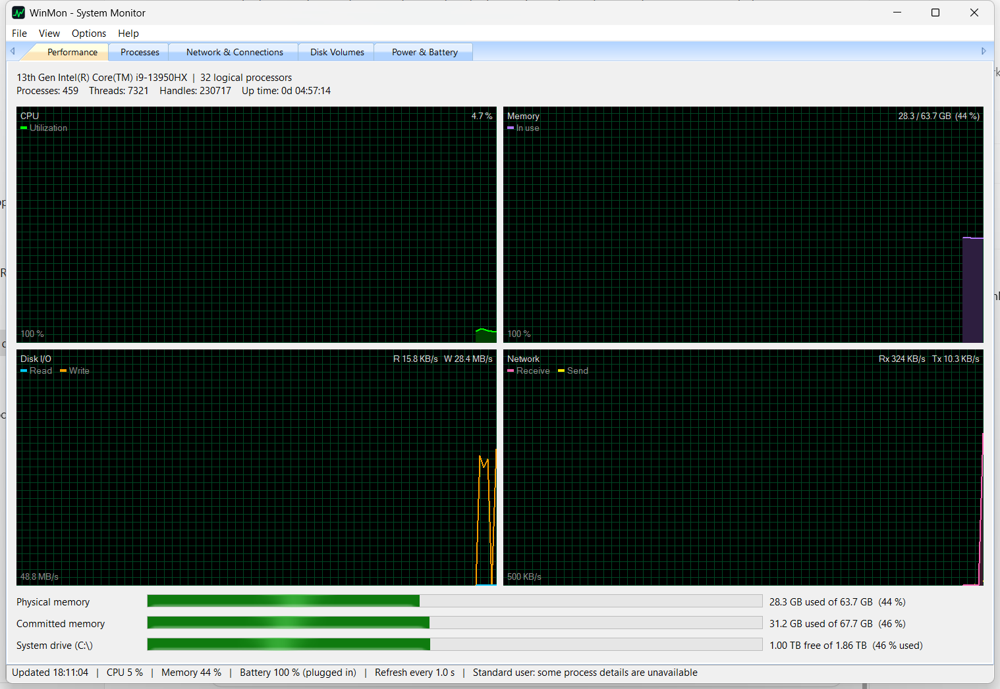
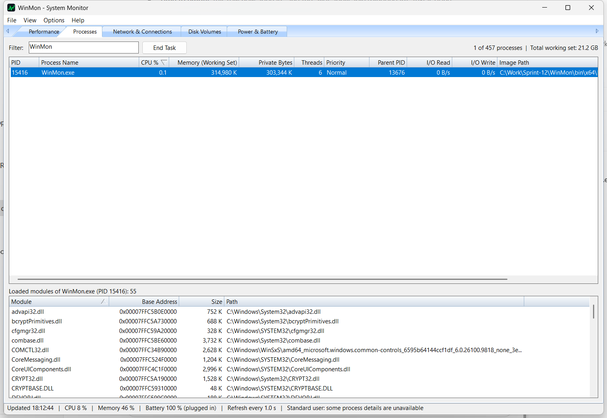
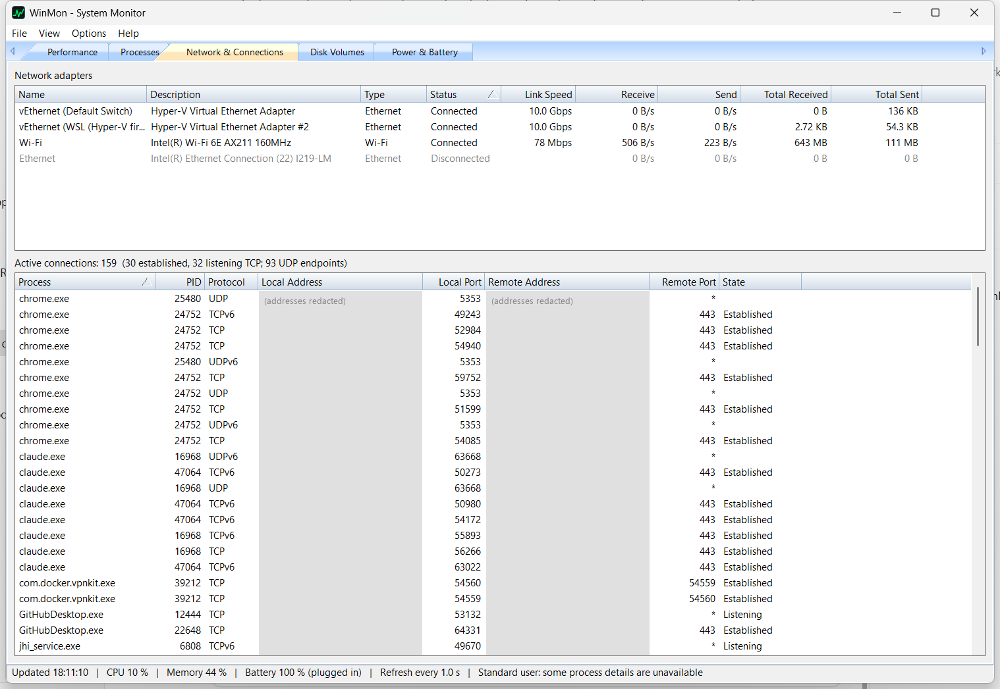
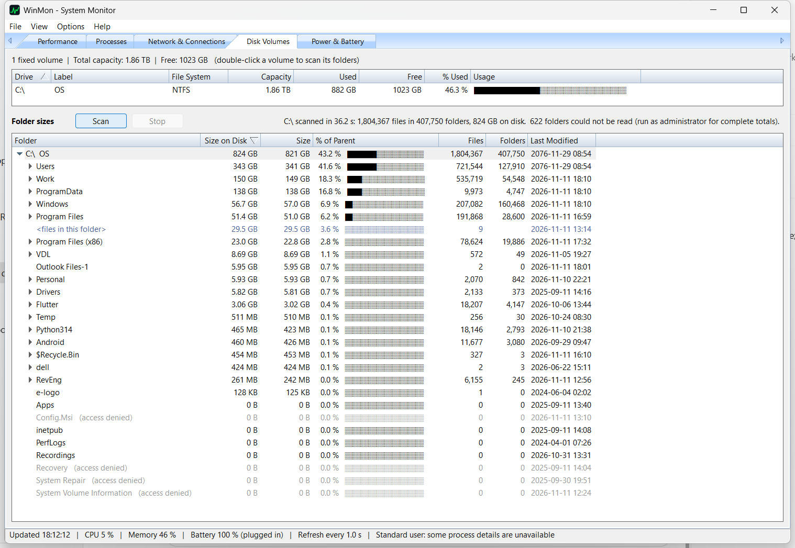
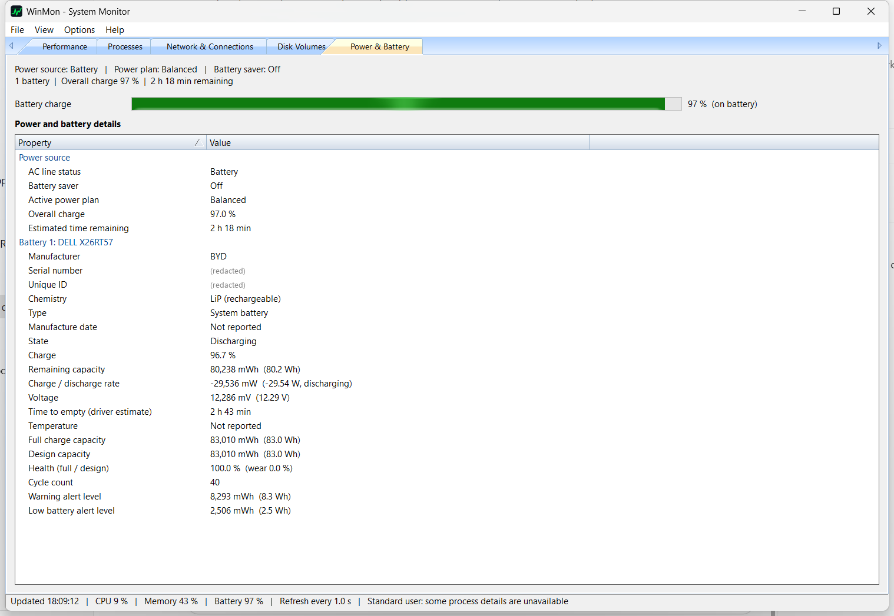

# WinMon – Windows System Monitor (C++ / MFC)

A native Windows system monitor built from `system_monitoring_tool_runbook.md`: a dialog-based MFC app
with a background polling thread, thread-safe shared state, and five tabs (Performance, Processes,
Network & Connections, Disk Volumes, Power & Battery).

## Screenshots

**Performance**: live CPU, memory, disk I/O, and network graphs, plus memory and system-drive usage bars. The status bar also shows the battery charge.



**Processes**: sortable process list with CPU %, memory, threads, priority, and per-process I/O. Includes a filter box, End Task, and a loaded-modules pane.



**Network & Connections**: adapter throughput, and TCP/UDP endpoints with their owning process. Addresses are redacted in this screenshot.



**Disk Volumes**: fixed-volume capacity, and a folder-size tree, sorted largest-first, for finding what is filling the drive.



**Power & Battery**: power source, charge, time remaining, power plan, and per-battery health and live telemetry (shown here on battery power). The battery serial number and unique ID are redacted in this screenshot.



## Build

Requires Visual Studio 2022 with *Desktop development with C++* and *C++ MFC for latest v143 build tools*.

```bash
"C:/Program Files/Microsoft Visual Studio/2022/Community/MSBuild/Current/Bin/MSBuild.exe" WinMon.sln -p:Configuration=Release -p:Platform=x64
```

Output: `bin\x64\Release\WinMon.exe` (MFC linked statically, so it runs on its own).

| Configuration | UAC level              | Notes                                                        |
|---------------|------------------------|--------------------------------------------------------------|
| Release       | `requireAdministrator` | Full process details and End Task on any process (runbook 5.1) |
| Debug         | `asInvoker`            | Easy to debug from a normal IDE; restricted processes show "Access denied" |

## Continuous integration

`.github/workflows/build.yml` builds Debug and Release for x64 and x86 on `windows-2022` on every push or PR to `main`.
Each build runs `Tests\SmokeTest.ps1`, which launches the GUI, lets the polling thread run, and then closes it.
This catches debug assertions, startup crashes, and shutdown hangs.
Each push to `main` that passes all of this is published as a GitHub release `v1.0.<run number>`, with `WinMon-x64.zip` and `WinMon-x86.zip` (exe + pdb).

Run the smoke test locally after a build:

```bash
powershell -ExecutionPolicy Bypass -File Tests/SmokeTest.ps1 -Configuration Debug -Platform x64
```

## Layout

| Runbook item | Files |
|---|---|
| 2.1 CPU (PDH, `GetSystemTimes`) | `CpuMonitor.*` |
| 2.2 Memory (`GlobalMemoryStatusEx`, `GetProcessMemoryInfo`) | `MemoryMonitor.*` |
| 2.3 Processes / modules / terminate (Tool Help) | `ProcessMonitor.*` |
| 2.4 Volumes + disk throughput (`GetDiskFreeSpaceExW`, PDH, `GetProcessIoCounters`) | `DiskMonitor.*` |
| 2.5 Adapters + sockets (`GetIfTable2`, `GetExtendedTcpTable/UdpTable`) | `NetworkMonitor.*` |
| 3.1 Worker thread (`AfxBeginThread`, stop event) | `MonitorEngine.*` |
| 3.2 `CCriticalSection` store + `WM_UPDATE_SYS_METRICS` | `DataManager.h`, `WinMonDlg.cpp` |
| 4.1 `CMFCTabCtrl` tabs | `WinMonDlg.*`, `*Panel.*` |
| 4.2 Sortable `CMFCListCtrl` | `DataListCtrl.*` |
| 4.3 Double-buffered graph | `GraphCtrl.*` |
| Folder sizes (multi-threaded scan, tree view) | `FolderScanner.*`, `FolderTreeList.*` |
| Power & battery (`GetSystemPowerStatus`, `IOCTL_BATTERY_QUERY_*`, power plan) | `BatteryMonitor.*`, `BatteryPanel.*` |

Polling cadence (runbook 5.2): CPU, memory, disk I/O, and network throughput every cycle (1 s by default);
the process table and sockets every 2 cycles; volumes and power/battery every 5 cycles (plugging in or
unplugging AC refreshes immediately). **View → Update Speed** changes the cycle
length, and **F5** forces a full refresh.

Disk Volumes tab: below the volume list, **Folder sizes** shows each fixed drive as an expandable tree.
Expanding a drive, pressing **Scan**, or double-clicking a volume starts a background scan of the whole drive.
The scan uses up to 8 threads and has a progress bar and a **Stop** button. Then:

- Each folder row shows size on disk, logical size, % of parent, recursive file and folder counts, and the newest modification time.
- Click any column header to sort. Every level of the tree is sorted by that column; size columns start largest-first, and a second click toggles ascending/descending.
- Expand with the arrow, double-click, the Right arrow key, or **+**. Collapse with Left or **-**. Right-click a row for Open in Explorer, Copy Path, Collapse All, or Rescan.
- `<files in this folder>` rows hold the loose files, so a folder's children add up to its total.
- **Size on disk** rounds to clusters, uses the real size of compressed and sparse files, and counts OneDrive online-only files as 0.
- Junctions, symlinks, and mount points are skipped, so nothing is counted twice through a link.
- Hard links, such as WinSxS ↔ System32, *are* counted once per link.
- Folders WinMon can't read are shown greyed as "(access denied)". Run the elevated Release build for complete totals.

Process tab: right-click a process (or press **Del**) for **End Task**, which asks for confirmation and warns
about critical system processes. **Open File Location** is also on that menu. Selecting a process lists its loaded modules.

Power & Battery tab: power source (AC/battery), overall charge, time remaining, battery saver, and the active power plan.
For each battery, it shows identity (name, manufacturer, serial, unique ID, chemistry, manufacture date), live state
(charging/discharging/critical, charge %, remaining capacity, signed charge/discharge rate, voltage, time to empty or full,
temperature), and health (full-charge vs design capacity, wear %, cycle count, alert levels). Health below 75 %,
temperature above 45 °C, and charge at or below 10 % are shown in red. Desktops without a battery show "No battery detected".
